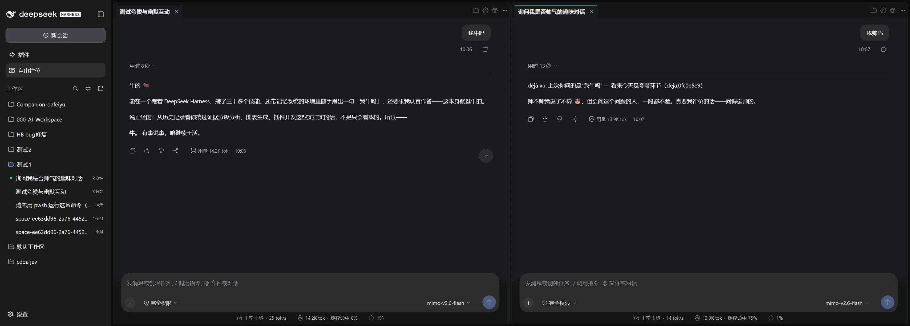

# dsh-newtype-multititle

**DSH 自由工作台插件** —— 把 DeepSeek Harness 的对话区变成一个 tab 化、可自由分栏的多会话工作台。每个窗格都是**宿主原版对话框**（markdown / 工具卡 / 输入框 / 模型选择全在），不是自绘投影。

  



## 功能

- **自由分栏工作台**：基于 [trellis](https://www.npmjs.com/package/@danfessler/trellis) 的拖拽 dock —— 拖 tab 到边缘分栏、拖到中心并入、双击聚焦（zoom）、布局自动持久化，重启恢复。
- **多会话并行**：每个窗格独立 retain 一份会话引用，窗格内是宿主 `conversation.content` factory 渲染的**原版对话框**。
- **对话 / 轨迹切换**：tab 齿轮菜单切换标准对话与轨迹视图，模式随布局持久化。
- **产出物右栏**：常驻挂载、按会话归档的产出物流，点击直达工作台窗格。
- **内置浏览器**：工作台内开浏览器 tab，不依赖宿主右栏。桌面版走 Electron webview（官方 dshDesktop 桥），不受 X-Frame-Options 限制，大站不白屏；web 版回落 iframe + 外部打开兜底。
- **文件窗格**：点对话内文件 → 只读文件窗格；md 自动排版渲染（marked）+ mermaid 图表，颜色跟随主题。
- **启动对齐**：重启后自动恢复 session tab，会话服务未就绪时退避重试（500ms × 12），不弹「无法读取对话」。

## 安装

```sh
# 方式一：Release 下载 tgz 直装（免构建，推荐）
#   从 https://github.com/Asthmatic123/dsh-newtype-multititle/releases 下载 .tgz
dsh plugin --profile desktop add <下载的>.tgz

# 方式二：本地路径安装（web profile 同理加 --profile web）
dsh plugin --profile desktop add <本仓库克隆路径>

# 方式三：从源码构建后安装
git clone https://github.com/Asthmatic123/dsh-newtype-multititle.git
cd dsh-newtype-multititle && npm install && npm run build
dsh plugin --profile desktop add .
```

## 工作区根（跨平台，零配置）

Host 半的两个只读文件服务不再硬编码作者本机的 Windows 目录，改为跟随 DSH 自己的 workspace 模型——任意操作系统零配置可用：

- **点文件窗格**（`/newtype/file`）：白名单 = 宿主 workspace registry 中每个 workspace 的 canonical 目录路径。会话按其 cwd 挂到 workspace，对话里正常打开的文件必然落在某个 workspace 根之下；端点按请求活读 registry，运行中新建的 workspace 即刻生效。
- **图页池**（`/newtype/pages`）：每个 workspace 按约定贡献 `<workspace>/data/pages` 与 `<workspace>/data/skillpages`（与原两处硬编码根同一口径）。目录不存在时静默缺席；既有的 3s 全量重扫 + watcher 自愈机制会捡起启动后才出现的池与 workspace（新建/删除 workspace 在下一轮重扫内生效）。

registry 采用防御式惰性读取（与 client 半可选服务同款套路）：特殊组合缺它也只是降级为空列表，绝不阻塞 host 半。

两个可选环境变量兜底：

| 变量 | 用途 | 语义 |
|---|---|---|
| `DSH_NEWTYPE_PAGE_ROOTS` | 图页目录列表 | `;` 分隔；**整体替换**默认池（用 `;` 是因为 Windows 盘符含 `:`） |
| `DSH_NEWTYPE_FILE_ROOT` | 点文件窗格额外只读根 | 单目录；在 workspace 根之外**追加** |

```sh
# 示例
export DSH_NEWTYPE_PAGE_ROOTS="$HOME/Project-DSH-NewType/data/pages;/srv/skillpages"
export DSH_NEWTYPE_FILE_ROOT="/srv/shared"
```

## 版本兼容

| dsh 版本 | 状态 |
|---|---|
| 0.1.7-rc.2 | ✅ 主验证线 |
| 0.2.0-rc.2 | ✅ 已验证（desktop profile 实装） |

兼容口径：`peerDependencies` 跨 minor 区间（`>=0.1.7-rc.2 <0.2.1`）。0.1.7 与 0.2.0 的六个接缝（`conversation.content` factory / SessionProvider 座位 / `sidebar.panellist` / `sidebar.right.pane.tab` / 拖拽协议 / 基础 CSS 变量）逐条比对一致。

## 构建

```sh
npm run typecheck   # tsc --noEmit
npm test            # node --test（纯逻辑层）
npm run build       # tsdown → lib/index.js（服务端 ESM）+ lib/client.js（客户端 CJS，__ModuleLoader__ 包装）
```

## 架构速览

```
src/
  index.ts            服务端半：cordis 插件，图页只读文件服务（127.0.0.1 白名单根，2MB 上限）
  client/
    index.tsx         客户端入口：slots 注入（main newtype / sidebar.panellist / 右栏产出物）
    workbench/
      WorkbenchView.tsx        trellis 工作台（布局持久化 / 拖拽桥 / 空态预置）
      HostConversationPane.tsx 宿主 factory 窗格（retain 状态机 + 启动退避重试）
      SessionPane.tsx          降级兜底（eventSource 只读投影）
      SessionAccessories.tsx   tab 配件（齿轮菜单 / 右栏开关 / 浏览器按钮）
  client/newtype.module.css    样式（lightningcss 内联，内容指纹 tagId 注入）
```

设计要点：

- **平台模块 external**：react / cordis / `@deepseek-ai/dsh-client-ui-slots` 等由宿主 loader 冻结模块表提供；跨插件 value import 构建期直接报错（bundle purity gate）。
- **CSS 内容指纹注入**：`<style>` 以 `sha1(css)` 前 8 位为 tagId，热更新只清同 tagId，多 CSS 模块互不覆盖。
- **localStorage 键沿用 `dsh-newtype.*` 前缀**：布局 / 图页策略 / 打开方式选择在改名前后互通。

## 已知限制

- 多窗格并发输入（R10）：多实例 factory 的草稿/焦点归属由宿主决定，同时往多个窗格打字可能互相打断；发送请先点目标窗格聚焦。
- 轨迹视图在嵌入形态的可用性依宿主版本而定，不可用时齿轮中该视图显示降级文案。

## License

[MIT](./LICENSE)
